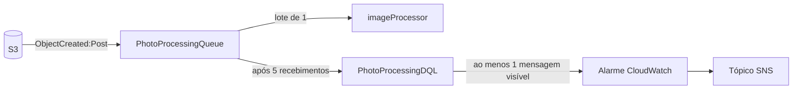

A stack da aplicação é declarada em `infra/template.yaml` com AWS SAM. O CloudFormation gerencia os recursos. As roles de implantação e os parâmetros de assinatura no SSM são pré-requisitos externos à stack. Veja [Implantação](/developers/operations/deployment).

Esta página explica o papel de cada recurso. Para valores exatos, consulte o template.

## Serviços utilizados

| Serviço | Recurso | Papel |
| --- | --- | --- |
| API Gateway | HTTP API | Entrada HTTP, CORS e validação do JWT. |
| Lambda | `studio-api` | Rotas do fotógrafo. |
| Lambda | `public-api` | Rotas do cliente, em `/public/*`. |
| Lambda | `public-access-authorizer` | Valida o token do link do cliente. |
| Lambda | `public-delivery-api` e `delivery-access-authorizer` | Leem a entrega pelo link do cliente e autorizam downloads. |
| Lambda | `payment-webhook` | Recebe notificações de pagamento. |
| Lambda | `PaymentReconcilerFunction` | Consulta os pedidos pendentes a cada duas horas. |
| Lambda | `fake-checkout` | Lado "provedor" do gateway fake, em `/dev/fake-checkout/{paymentId}`. Só para dev. |
| Lambda | `PostConfirmationFunction` | Criação do perfil no cadastro. |
| Lambda | `ImageProcessorFunction` | Geração de derivados. |
| Lambda | `DeletePhotosGalleryFunction` | Exclusão de fotos e galerias em segundo plano. |
| Lambda | `EventDeletionReconcilerFunction` | Conferência periódica das exclusões de evento. |
| Lambda Layer | `SharpLayer` | Binário nativo do sharp para arm64. |
| Cognito | User Pool e App Client | Identidade e tokens do fotógrafo. |
| DynamoDB | `lumora-app` | Todos os metadados. |
| S3 | `PhotosBucket`, `MediaBucket`, `DeliveriesBucket` e `WebBucket` | Originais, derivados, fotos editadas e frontend, respectivamente. |
| CloudFront | `MediaDistribution`, `DeliveriesDistribution` e `WebDistribution` | Derivados, downloads assinados e frontend. |
| SQS | fila de processamento e DLQ | Desacoplamento e retry do processamento de imagens. |
| SQS | fila de exclusão e DLQ | Trabalho de exclusão de fotos e galerias. |
| EventBridge | regras agendadas | Disparam a reconciliação de exclusões a cada 15 minutos e a de pagamentos a cada duas horas. |
| SNS | tópico de alarme e assinatura por e-mail | Destino dos alarmes operacionais. |
| SSM Parameter Store | Parâmetros externos | Segredo do fake, credenciais de gateways e chaves de assinatura de downloads. |
| CloudWatch | logs, métricas e alarmes | Logs das funções e da HTTP API em produção, consultas salvas e seis alarmes. |
| IAM | políticas por função | Permissões mínimas de cada Lambda. |

## Funções Lambda

As funções compartilham o mesmo código-fonte, `services/api`, e são empacotadas separadamente pelo esbuild, cada uma a partir do seu handler. Todas rodam em Node.js 22 sobre arm64. Os padrões do template são 10 s e 256 MB.

| Função | Gatilho | Timeout | Memória |
| --- | --- | --- | --- |
| `studio-api` | HTTP API, authorizer Cognito nas rotas protegidas | 29 s | 256 MB |
| `public-api` | HTTP API, `PublicAccessAuthorizer` | 20 s | 256 MB |
| `public-access-authorizer` | Lambda authorizer da HTTP API | 10 s | 256 MB |
| `public-delivery-api` | HTTP API, `DeliveryAccessAuthorizer` | 10 s | 256 MB |
| `delivery-access-authorizer` | Lambda authorizer da HTTP API | 10 s | 256 MB |
| `payment-webhook` | HTTP API, validação da notificação pelo adapter | 20 s | 256 MB |
| `PaymentReconcilerFunction` | Agendamento a cada duas horas | 300 s | 256 MB |
| `fake-checkout` | HTTP API, sem authorizer (`GET` e `POST /dev/fake-checkout/{paymentId}`) | 10 s | 256 MB |
| `PostConfirmationFunction` | Cognito, `PostConfirmation` | 10 s | 256 MB |
| `ImageProcessorFunction` | SQS, fila de processamento | 60 s | 1536 MB |
| `DeletePhotosGalleryFunction` | SQS, fila de exclusão | 60 s | 256 MB |
| `EventDeletionReconcilerFunction` | Agendamento, a cada 15 minutos | 60 s | 256 MB |

O `imageProcessor` tem mais memória e tempo porque decodifica e redimensiona imagens de até 50 MB em memória. As duas funções de fila usam lote de 1 mensagem e no máximo 30 invocações simultâneas.

### Layer do sharp

O sharp depende de um binário nativo compilado para a plataforma de execução. Por isso ele não entra no bundle do esbuild: é marcado como `External` e fornecido pela `SharpLayer`, construída por `infra/layers/sharp/Makefile` para linux arm64.

<Warning>
  A versão do sharp no `Makefile` precisa ser igual à de `services/api/package.json`. Um comentário no `Makefile` registra essa exigência; não há verificação automática.
</Warning>

### Permissões

O template declara as políticas por função. A API do Studio emite credenciais de upload, confirma arquivos de entrega e envia trabalhos às filas. A API pública de entregas lê os metadados e o parâmetro da chave de assinatura. Os consumidores de fila têm permissões próprias para ler ou remover objetos. As funções de pagamento leem os parâmetros SSM necessários ao respectivo fluxo, e o reconciliador consulta o índice de pendentes.

As permissões de runtime são separadas das roles do GitHub Actions e do CloudFormation. O parâmetro `LambdaPermissionsBoundaryArn` permite associar uma permissions boundary às funções configuradas no template.

## API Gateway

A HTTP API tem estágios `dev` e `prod`.

- As rotas protegidas do Studio usam JWT do Cognito e o scope `aws.cognito.signin.user.admin`. `GET /health` é aberto.
- O acesso ao evento usa `x-access-token`. O acesso à entrega usa `x-delivery-token`. Os authorizers públicos usam cache de 60 segundos, e as operações conferem o acesso atual novamente. Veja [Acesso público do cliente](/developers/flows/public-client-access) e [Entregas e downloads](/developers/flows/deliveries).
- O webhook valida a credencial no adapter do provedor. Veja [Pagamentos](/developers/flows/payment-and-delivery).
- O CORS da HTTP API aceita qualquer origem em dev e usa a origem da `WebDistribution` em prod.

## Cognito

O User Pool usa o e-mail como nome de usuário, sem distinção de maiúsculas, e verifica o e-mail automaticamente.

O App Client não tem secret, pois é usado por uma SPA, e habilita dois fluxos: SRP e refresh token. A revogação de tokens está habilitada, e `PreventUserExistenceErrors` evita que a tela de login revele se um e-mail está cadastrado.

O gatilho `PostConfirmation` invoca a `PostConfirmationFunction`.

## DynamoDB

Há uma única tabela, `lumora-app`, em modo sob demanda (`PAY_PER_REQUEST`), com chave `PK` e `SK` e dois índices globais com projeção completa. O `GSI1` atende listagens e reconciliação de exclusões. O `GSI2` é esparso e lista pedidos aguardando pagamento.

O nome da tabela é fixo. O template ativa proteção contra exclusão e recuperação point-in-time (PITR). A tabela, o User Pool e os buckets de originais, mídia e entregas usam políticas de retenção do CloudFormation.

<Note>
  O `GSI1` tem dois usos principais: a lista de pedidos do fotógrafo e a fila de reconciliação das exclusões de evento. Também guarda entradas de entregas e de tentativas de pagamento. A tabela tem TTL no atributo `ttl`, usado só para limpar as marcas de notificação de pagamento (`WEBHOOK#`).
</Note>

O modelo lógico está em [Modelo de dados](/developers/architecture/data-model).

## S3

Os quatro buckets bloqueiam acesso público. O `PhotosBucket` guarda os originais e o `MediaBucket` guarda os derivados. Os outros dois guardam os arquivos de entrega e o frontend.

| Configuração | Valor e motivo |
| --- | --- |
| Acesso público | Totalmente bloqueado. |
| ACLs | Desabilitadas (`BucketOwnerEnforced`). |
| Criptografia | SSE-S3 (AES256) por padrão. |
| Transporte | Uma bucket policy nega qualquer acesso sem TLS. |
| Versionamento | Habilitado. Cada envio cria uma versão imutável, que o processador usa como identidade do original. |
| Lifecycle | Versões não correntes expiram em 14 dias. Uploads multipart incompletos são abortados em 14 dias. Uma regra remove marcadores de exclusão expirados. |
| CORS | Permite `GET` e `POST` a partir da distribuição web em prod ou de `WebOrigin` em dev. `SecondaryWebOrigin` pode acrescentar uma origem. |
| Notificação | `s3:ObjectCreated:Post`, com prefixo `photos/` e sufixo `/original.jpeg`, para a fila SQS. |

### Bucket de mídia e CloudFront

O `MediaBucket` tem acesso público bloqueado, ACLs desabilitadas, criptografia AES256 e uma policy que nega tráfego sem TLS. A policy libera `s3:GetObject` apenas ao serviço `cloudfront.amazonaws.com`, restrito à `MediaDistribution`. A distribuição usa um Origin Access Control (sigv4), HTTP/2 e HTTP/3, redireciona HTTP para HTTPS, aceita `GET` e `HEAD` e usa a política de cache `CachingOptimized`.

O domínio da distribuição chega às funções `studio-api` e `public-api` como `MEDIA_BASE_URL`. Detalhes em [Reprocessamento e mídia](/developers/flows/reprocessing-and-media#mídia-e-cloudfront).

### Entregas e hospedagem web

O `DeliveriesBucket` recebe fotos editadas em `uploads/`. Esse prefixo expira após dois dias. O backend copia arquivos confirmados para `files/`, e a `DeliveriesDistribution` os serve por OAC, exigindo URLs assinadas por uma chave do grupo confiável.

O `WebBucket` recebe o build da SPA. A `WebDistribution` lê o bucket via OAC e usa uma CloudFront Function para reescrever rotas da SPA. Veja [Implantação](/developers/operations/deployment).

### Layout das chaves

```
photos/{ownerId}/{eventId}/{galleryId}/{photoId}/original.jpeg
photos/{ownerId}/{eventId}/{galleryId}/{photoId}/attempts/{attemptId}/thumb-v1.webp
photos/{ownerId}/{eventId}/{galleryId}/{photoId}/attempts/{attemptId}/preview-v1.webp
```

As chaves são montadas e interpretadas por `S3KeyBuilder`, em `services/api/src/shared/storage`. O `v1` vem da constante `IMAGE_PROCESSING_VERSION`.

O filtro de sufixo da notificação é o que impede um ciclo: os derivados gravados pelo `imageProcessor` terminam em `.webp` e não geram novos eventos.

### Por que a notificação é só para `Post`

O filtro usa `s3:ObjectCreated:Post`, e não `s3:ObjectCreated:*`. Somente objetos criados por formulário POST, que é como o navegador envia, disparam o processamento. Um original gravado com `PutObject` ou por cópia não é processado.

## SQS

Há duas filas standard, cada uma com sua DLQ. A tabela e o diagrama abaixo descrevem a de processamento de imagens. A de exclusão é descrita [adiante](#fila-de-exclusão).



| Configuração | Valor |
| --- | --- |
| Tipo da fila | Standard, com entrega pelo menos uma vez |
| Visibility timeout | 360 s |
| Tentativas antes da DLQ | 5 (`maxReceiveCount`) |
| Retenção da DLQ | 14 dias |
| Tamanho do lote | 1 mensagem por invocação |
| Concorrência máxima | 30 invocações simultâneas |
| Resposta parcial | `ReportBatchItemFailures` habilitado |

Uma `QueuePolicy` permite que o S3, a partir do `PhotosBucket` e da própria conta, envie mensagens para a fila. A `studio-api` também publica nela, para pedir reprocessamentos. Veja [Reprocessamento e mídia](/developers/flows/reprocessing-and-media).

Os três tempos do processamento foram escolhidos em conjunto:

```
timeout da Lambda (60 s)  <  lease de processamento (90 s)  <  visibility timeout (360 s)
```

O motivo dessa ordem está em [Processamento de imagens](/developers/flows/image-processing#os-três-tempos).

<Note>
  O recurso da DLQ se chama `PhotoProcessingDQL` no template, com as letras trocadas. O nome é apenas o identificador lógico do CloudFormation.
</Note>

### Fila de exclusão

A `DeletePhotosGalleryQueue` recebe os trabalhos de exclusão de fotos e galerias e é consumida pela `DeletePhotosGalleryFunction`. Tem visibility timeout de 360 s, `maxReceiveCount` de 5 e uma DLQ com retenção de 14 dias. O consumidor usa lote de 1 mensagem, até 30 invocações simultâneas e `ReportBatchItemFailures`.

A função tem `RecursiveLoop: Allow` porque ela mesma publica na fila a próxima página de fotos a excluir. Quem publica na fila é a `studio-api`, o reconciliador e o próprio consumidor. Veja [Exclusão de fotos e galerias](/developers/flows/photo-and-gallery-deletion).

### Dependência circular entre bucket e fila

O bucket precisa da fila para configurar a notificação, e a política da fila precisa restringir o envio ao bucket. Para evitar a referência circular:

- o nome do bucket é composto só por pseudoparâmetros: nome da stack, conta e região;
- a política da fila reconstrói o ARN do bucket com os mesmos pseudoparâmetros, sem referenciar o recurso;
- o bucket declara `DependsOn` na política da fila, para que ela exista antes da notificação.

## Observabilidade provisionada

A stack define logs das funções, access logs da HTTP API em produção, consultas salvas no Logs Insights e seis alarmes com destino ao SNS. Veja [Observabilidade](/developers/operations/observability).

## Parâmetros e saídas da stack

A configuração por ambiente fica em `infra/samconfig.toml`. O frontend recebe `ApiUrl`, `UserPoolId` e `UserPoolClientId` no build. Os workflows usam `WebBucketName` e `WebDistributionId` para publicar. As distribuições de mídia e entregas saem como `MediaBaseUrl` e `DeliveryDownloadBaseUrl`.
