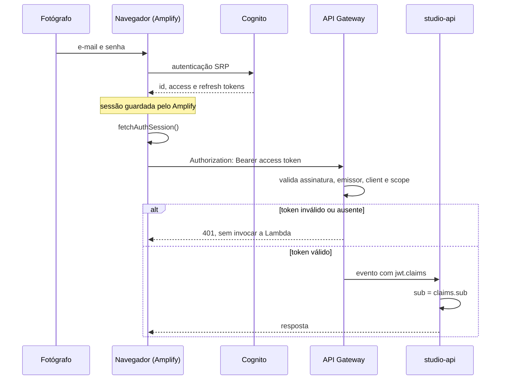
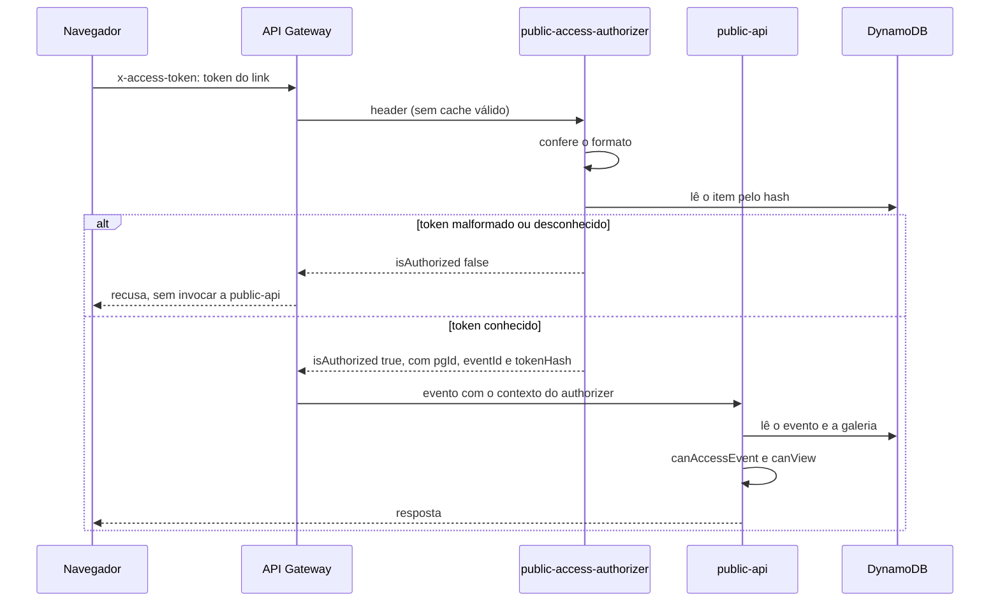

## Objetivo

Identificar quem faz cada requisição e garantir que só alcance os dados a que tem direito.

A API tem dois públicos, com mecanismos separados:

- o **fotógrafo**, no Lumora Studio, autenticado pelo Cognito;
- o **cliente**, na área pública, identificado pelo token do link do evento. Veja [Acesso do cliente pelo link](#acesso-do-cliente-pelo-link).

## Componentes

| Componente | Papel |
| --- | --- |
| Cognito User Pool | Guarda as credenciais e emite os tokens. |
| Amplify, no navegador | Conduz cadastro e login, guarda e renova a sessão. |
| JWT authorizer do API Gateway | Valida o token antes de invocar a Lambda. |
| `getPhotographerId` | Extrai o `sub` das claims já validadas. |

## Sequência

### Entrada

`studio/StudioRoutes.tsx` envolve todas as rotas do Studio no componente `Authenticator`. Sem sessão, ele mostra as telas de entrada e cadastro. O cadastro pede e-mail, senha e o atributo `name`.

O login usa o fluxo SRP: a senha não trafega em texto para o Cognito. O App Client não tem secret.

### Envio do token

`studio/api.ts` chama `fetchAuthSession()` antes de cada requisição e envia o **access token** no header `Authorization`. O Amplify renova o token com o refresh token quando necessário.

Se não houver token, a requisição nem é feita: o cliente lança `ApiError` 401 `UNAUTHENTICATED`.

### Validação no API Gateway

O authorizer confere:

- a assinatura e a validade do token;
- o emissor, que deve ser o User Pool da stack;
- o client, que deve ser o App Client da stack;
- o scope `aws.cognito.signin.user.admin`.

A exigência do scope tem um efeito prático: só o access token é aceito. O id token do Cognito não carrega esse scope e é recusado.

Uma requisição recusada pelo authorizer não chega à Lambda e não aparece nos logs da `studio-api`.

### Identidade na Lambda

`http/getPhotographerId.ts` lê `requestContext.authorizer.jwt.claims.sub`. Se o claim faltar, lança `UnauthenticatedError`, que vira 401.

Esse `sub` é o único identificador de fotógrafo que o backend usa. Ele é passado a cada caso de uso e entra nas chaves do DynamoDB.

## Autorização

O Lumora não tem papéis nem permissões. A regra é uma só: o fotógrafo acessa o que está sob o próprio `sub`.

A regra é aplicada pelo modelo de dados, não por verificações espalhadas:

- o `sub` nunca vem de path, query, body ou cursor;
- toda chave de evento, galeria e foto contém o `sub`;
- um id de recurso de outro fotógrafo leva a uma chave inexistente, e a resposta é 404.

Responder 404, e não 403, evita revelar que o recurso existe.

O teste `studioApi.isolation.dynamodb.spec.ts` exercita esse isolamento contra o DynamoDB Local, com dois fotógrafos.

## Sessão no frontend

O frontend trata a troca de usuário no mesmo navegador como um risco:

- as query keys de dados do fotógrafo incluem o `sub`; a consulta de saúde usa `['health']`, sem dados pessoais;
- `useMe` recusa uma resposta de `/me` cujo `id` seja diferente do `sub` da sessão;
- `useBootstrapMe` confere o usuário ativo de novo antes de gravar o resultado no cache;
- o logout cancela as queries, encerra a sessão, limpa o cache e descarta as filas de upload.

## Saída

`signOut()` do Amplify encerra a sessão local. O App Client tem revogação de tokens habilitada.

## Falhas

| Situação | Resultado |
| --- | --- |
| Token ausente, expirado ou de outro pool | 401 do API Gateway |
| Token sem o scope exigido | 403 do API Gateway |
| Claim `sub` ausente na Lambda | 401 `UNAUTHENTICATED` |
| Sessão local ausente | `ApiError` 401, sem requisição |

<Note>
  Os dois primeiros status são o comportamento padrão do JWT authorizer do API Gateway. O código do Lumora não os define nem os testa.
</Note>

## Acesso do cliente pelo link

O cliente não tem conta. Ele recebe do fotógrafo um link no formato `/g/{token}`. O link vale para o evento inteiro e alcança todas as suas galerias. A geração do link está em [Eventos e galerias](/developers/flows/events-and-galleries#link-do-cliente).

### Componentes

| Componente | Papel |
| --- | --- |
| `PublicLayout`, no navegador | Lê o token da URL e cria o cliente da API pública. |
| `public-access-authorizer` | Lambda authorizer do API Gateway. Autentica o token antes de invocar a `public-api`. |
| `public-api` | Lambda das rotas `/public/*`. Confere o direito de cada operação. |
| Item do token no DynamoDB | Guarda o hash do token, o fotógrafo, o evento e a validade. |

### Sequência

### No navegador

A rota `/g/:token/*` não passa pelo `Authenticator` do Studio. `createPublicApi` envia o token no header `x-access-token` em toda chamada.

O token fica só na memória do cliente da API. Ele não vai para `localStorage`, `sessionStorage` nem cookie. Recarregar a página parte de novo do token que está na URL. Antes de chamar a API, o frontend descarta o que claramente não tem o formato de um token.

### No authorizer

O authorizer só autentica. Ele confere o formato do token, 43 caracteres base64url, calcula o SHA-256 e busca o item do token por esse hash. Token malformado e token desconhecido recebem a mesma recusa, para não revelar qual foi o caso.

Com o token reconhecido, o authorizer injeta no contexto `pgId`, `eventId` e `tokenHash`. O token nunca é registrado em log.

O API Gateway guarda a resposta do authorizer em cache por 60 segundos, por valor do header. Como a resposta em cache vale para todas as rotas, o authorizer não confere prazo nem revogação. Uma falha de infraestrutura no authorizer é propagada: o gateway responde 500 e não guarda a negação em cache.

### Na public-api

Dono e evento vêm só do contexto do authorizer. Nenhuma rota pública os aceita do path, da query ou do corpo. `getPublicAccess` valida o contexto e lança `UnauthenticatedError` se faltar algum campo.

Cada operação confere o próprio direito, lendo o evento a cada requisição. `canAccessEvent` exige:

- o evento em `PUBLISHED`;
- o hash apresentado igual ao link registrado no evento;
- o instante atual antes de `expiresAt` do link e, se houver, antes de `revokedAt`.

Como a validade é lida do evento, um link substituído ou revogado deixa de valer na requisição seguinte, mesmo com a resposta do authorizer em cache. `event.expiresAt` não entra nessa regra.

Para ver uma galeria, `canView` exige também que ela seja do evento e esteja em `ACTIVE`. Uma galeria de outro evento não é encontrada, porque a leitura usa a partição do evento do token.

### Falhas do cliente

| Situação | Resultado |
| --- | --- |
| Header `x-access-token` ausente | Recusa do API Gateway |
| Token malformado ou desconhecido | Recusa do API Gateway, sem invocar a `public-api` |
| Contexto do authorizer incompleto | 401 `UNAUTHENTICATED` |
| Link vencido, revogado ou substituído, ou evento fora de `PUBLISHED` | 403 `ACCESS_DENIED`, com a mesma mensagem para todos os casos |
| Galeria de outro evento, inexistente ou em exclusão | 404 `NOT_FOUND` |

<Note>
  O status das recusas do API Gateway é o comportamento padrão de um Lambda authorizer com respostas simples. O código do Lumora não o define.
</Note>

O que o cliente faz depois de entrar, como seleção de fotos e pedido, ainda não está documentado nesta seção de fluxos.

## O que não está implementado

- **Login social, MFA e recuperação de conta personalizada.** O User Pool usa a configuração básica.
