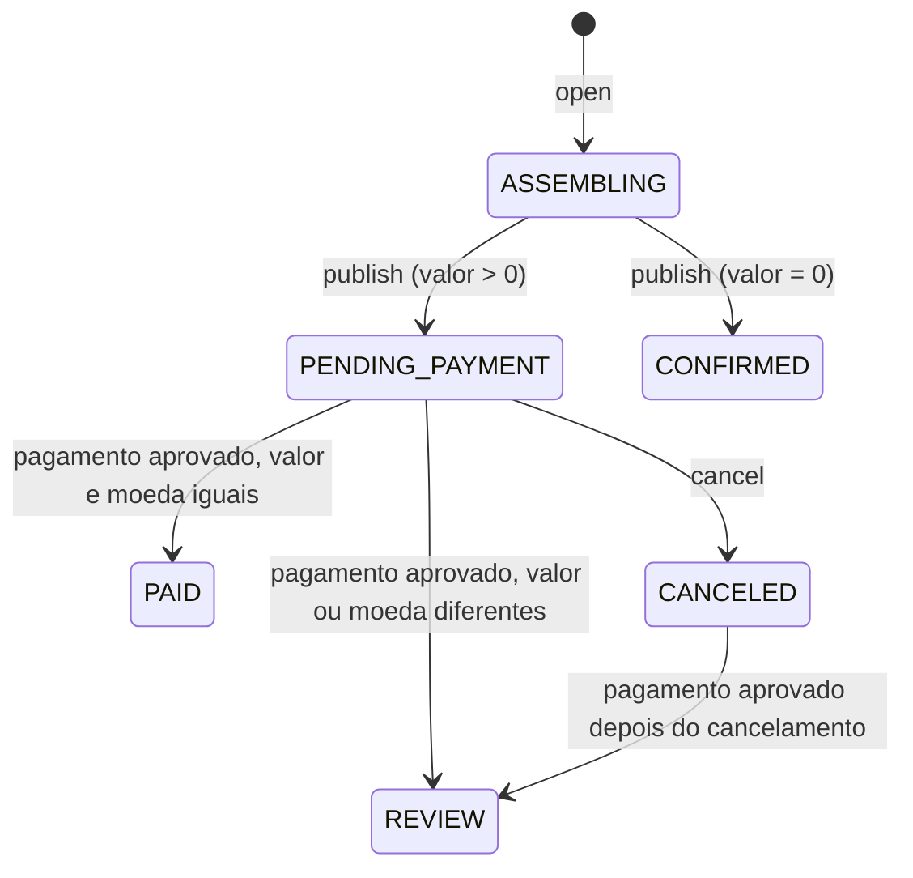
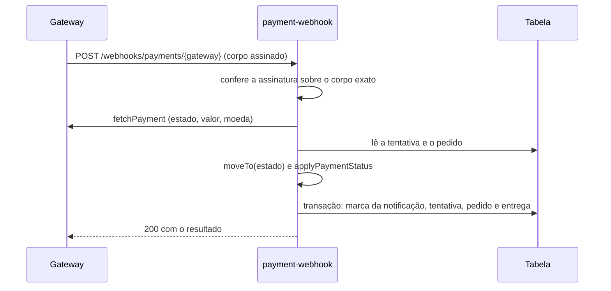

Um pedido `PENDING_PAYMENT` é pago em uma **tentativa de pagamento** (`Payment`). O cliente abre a tentativa pelo link, o servidor pede um checkout ao gateway, e quem decide o resultado é o **webhook**: ele consulta o gateway, compara valor e moeda com o pedido e move o pedido para `PAID` ou `REVIEW`. Um pedido pago ganha o registro da **entrega** na mesma transação.

## O que existe hoje e o que falta

O fluxo inteiro está implementado, mas só com um gateway: o `fake`, que serve para desenvolvimento e testes. Nenhum provedor real está integrado.

| Parte | Estado |
| --- | --- |
| Abrir o pagamento do pedido e criar o checkout | Implementado, com o gateway `fake` (`PAYMENT_GATEWAY: fake` no template) |
| Webhook que confere o gateway e move o pedido | Implementado: `POST /webhooks/payments/{gateway}` |
| Página de checkout de mentira (`/dev/fake-checkout`) | Implementada, só para dev |
| Estados `PAID` e `REVIEW` do pedido | Implementados |
| Registro da entrega (`Delivery`) de um pedido pago ou confirmado | Implementado: nasce `PENDING`, na mesma transação do pedido |
| Gateway de um provedor real | Não implementado. Há uma porta (`ICheckoutGateway`) e um `GatewayFactory`, e o fake é o único adapter |
| Reconciliação com o gateway (conferir pagamentos que o webhook perdeu) | Não implementada. Não existe função agendada para isso |
| Estorno e reembolso | Não implementados. Um pagamento `AUTHORIZED` só pode terminar pago |
| Resolver um pedido `REVIEW` | Não implementado. Nenhum código o tira desse estado, e o Studio só o mostra |
| Subir as fotos tratadas e gerar o link de download | Não implementado. A entrega fica `PENDING` |
| Baixar os originais ou as tratadas | Não implementado. Não há rota de download. Existe só a regra `canDownload`, uma função pura sem chamador |

Criar o registro da entrega e baixar as fotos são passos distintos. O primeiro existe; o segundo não.

## Estados do pedido

O pedido ganhou dois estados além dos descritos em [Pedidos](/developers/flows/orders#estados):

| Estado | Significado |
| --- | --- |
| `PAID` | O gateway confirmou o pagamento com exatamente o valor e a moeda do pedido. |
| `REVIEW` | Houve um pagamento aprovado que não fecha com o pedido. Ninguém entrega nada até uma pessoa decidir. |

`PAID` e `REVIEW` não regridem. O motivo de um `REVIEW` (`AMOUNT_MISMATCH` ou `PAID_AFTER_CANCEL`) não é gravado no pedido: sai apenas no log do webhook.

## Estados da tentativa

Cada `Payment` guarda o estado que o gateway informou, mais um estado só nosso:

| Estado | Significado |
| --- | --- |
| `CREATING` | A tentativa existe, mas o gateway ainda não devolveu o checkout. Só existe localmente. |
| `PENDING` | O checkout foi criado e espera o pagamento. |
| `PROCESSING`, `REQUIRES_ACTION`, `AUTHORIZED` | Estados intermediários informados pelo gateway. |
| `SUCCEEDED` | Pago. Final. |
| `FAILED`, `CANCELED`, `EXPIRED` | Terminou sem cobrança. Finais. O cliente pode abrir outra tentativa. |

As transições são idempotentes: repetir o estado atual não faz nada. Um estado final nunca é trocado por outro, então um "recusado" que chega depois de "pago" não desfaz o pagamento. `AUTHORIZED` só pode terminar em `SUCCEEDED`, porque recusa ou cancelamento depois de autorizar chegariam como estorno, que ainda não existe.

A tentativa guarda o valor do pedido no momento da abertura (`totalCents` e `currency`), o nome do gateway, um retrato dos dados do cliente do evento e o `checkout`, que é `null` até o gateway devolver `gatewayCheckoutId` e `checkoutUrl`.

## Abrir o pagamento

**Rota:** `POST /public/payment/{orderId}`, sem corpo, pelo `PublicAccessAuthorizer`, com limite de 20 requisições por segundo e rajada de 40. O valor cobrado é o do pedido; nada que o cliente enviar entra na cobrança.

`CreatePaymentOrder` decide, nesta ordem:

| Situação | Resultado |
| --- | --- |
| O link não dá acesso ao evento (`canAccessEvent`) | `EventAccessDeniedError`, 403 `ACCESS_DENIED` |
| O pedido não é do dono e do evento do link, ou não existe | `OrderNotFoundError`, 404 `NOT_FOUND` |
| O pedido não está montado em `PENDING_PAYMENT` | `OrderNotPayableError`, 409 `ORDER_NOT_PAYABLE` |
| Há uma tentativa ativa que não terminou sem cobrança | Devolve a **mesma** tentativa, com o mesmo checkout |
| O evento não tem cliente, ou o cadastro não existe | `InvalidCustomerError`, 409 `CUSTOMER_REQUIRED` |
| Caso contrário | Cria uma tentativa `CREATING` com o gateway `fake` e abre-a |

O link é conferido antes do pedido, para que a resposta não revele se o pedido existe. Diferentemente de continuar um pedido, abrir o pagamento sempre passa por `canAccessEvent`: com o link vencido, revogado ou substituído, a resposta é 403.

O gateway exige os dados do pagador, por isso o evento precisa ter um [cliente](/developers/flows/customers) vinculado (`event.customerId`) antes de o pagamento abrir.

`DynamoDbPaymentRepository.open` grava, numa transação:

| Operação | Condição | Efeito |
| --- | --- | --- |
| `Put` da tentativa (`ORDER#{orderId}` / `PAYMENT#{paymentId}`) | não existir | Cria a tentativa em `CREATING`. |
| `Update` do pedido | existe, está `PENDING_PAYMENT` e `activePaymentId` é o lido (ou não existe) | `SET activePaymentId` com a tentativa nova. |
| `ConditionCheck` do evento | o link ainda dá acesso | Nada. |

O ponteiro `activePaymentId` no pedido é a exclusão mútua: dois cliques simultâneos disputam a mesma condição, e só um troca o valor lido. O perdedor lê de novo e devolve a tentativa do vencedor. O limite é `MAX_PAYMENT_ATTEMPTS` (3) leituras; depois disso, 409 `CONFLICT` (`WriteConflictError`).

### Resposta

`toPublicPaymentDto` devolve `paymentId`, `orderId`, `status` e `checkoutUrl`. `checkoutUrl` só é `null` se o gateway já informou o resultado antes de o checkout ser gravado. A tela então consulta o pedido para ver o que aconteceu.

## Criar o checkout

`CreateCheckout` pede o checkout ao gateway quando a tentativa ainda não tem um (`awaitsCheckout`: sem checkout e sem estado final). Como a chamada ao gateway é externa e pode cobrar, ela é exclusiva:

1. **Reivindicar a vez.** `claimCheckoutCreation` grava `checkoutAttemptId` e `checkoutLeaseUntil` na tentativa, com um lease de `CHECKOUT_CLAIM_LEASE_MS` (30 s, maior que o timeout de 10 s da Lambda). A transação confere que a tentativa ainda espera o checkout, que o pedido continua `PENDING_PAYMENT` apontando para ela e que o link ainda dá acesso. Um cancelamento ou um link revogado depois da leitura não chega ao gateway.
2. **Pedir o checkout.** `createCheckout` recebe a tentativa e usa `idempotencyKey()` (`checkout:create:{paymentId}`). Repetir a chamada devolve o mesmo checkout, sem criar outra cobrança. Se o gateway falha, a vez é devolvida (`releaseCheckoutClaim`) e a próxima chamada repete na hora.
3. **Gravar.** `attachCheckout` grava o checkout e leva a tentativa de `CREATING` para `PENDING`. Se o webhook já moveu a tentativa antes, só o checkout entra, e o estado informado fica.

Quem não consegue a vez devolve a tentativa se o checkout já foi gravado; senão, responde 409 `CONFLICT`, e o cliente repete. Se a Lambda cair no meio, o lease vence e outra chamada assume.

## O gateway fake

`FakeCheckoutGateway` (adapter `fake` do `GatewayFactory`) imita um provedor sem sair da AWS:

- **Pagamento do gateway.** `createCheckout` grava um item `FAKEPAY#{gatewayPaymentId}` / `META` na mesma tabela, com id `fake_{paymentId}`, valor, moeda e estado `PENDING`. O `checkoutUrl` é `{FAKE_CHECKOUT_URL}?payment={id}`, que aponta para a página `/dev/fake-checkout` do frontend.
- **Notificação assinada.** O corpo é `{ id, paymentId }`, e a assinatura é um HMAC-SHA256 do corpo em hexadecimal, no cabeçalho `x-fake-signature`. A verificação compara em tempo constante.
- **Fonte da verdade.** `fetchPayment` devolve o que o fake guardou: estado, valor e moeda.
- **Decisão.** `decide(approve | decline, paidCents?)` muda o estado para `SUCCEEDED` ou `FAILED` e devolve a notificação assinada. `paidCents` simula um valor pago diferente do cobrado, para exercitar o `REVIEW`.

A função `fake-checkout` (`FakeCheckoutFunction`) expõe esse lado ao navegador, sem authorizer, com limite de 5 requisições por segundo e rajada de 10:

| Rota | Efeito |
| --- | --- |
| `GET /dev/fake-checkout/{paymentId}` | Lê o pagamento do fake (`gatewayPaymentId`, `status`, `amountCents`, `currency`). |
| `POST /dev/fake-checkout/{paymentId}` | Aprova ou recusa (`decision`, e `paidCents` opcional) e devolve a notificação assinada e o caminho do webhook. |

A página `FakeCheckoutPage` mostra o valor cobrado, permite informar outro valor pago, aprova ou recusa, entrega a notificação ao webhook e oferece **Entregar de novo**, que reenvia a mesma notificação para mostrar que a reentrega não muda nada. O `paymentId` da rota precisa ter o formato `fake_...`.

<Warning>
  O fake e a página de checkout foram feitos só para desenvolvimento, e o template comenta que eles saem quando o gateway real entrar. Nada, porém, impede que sejam publicados: a rota `/dev/fake-checkout` do frontend está sempre registrada, e as rotas `/dev/fake-checkout/{paymentId}` da API não têm authorizer. Quem decide o resultado de um pagamento fake é quem acessa essa página.
</Warning>

## O webhook

**Rota:** `POST /webhooks/payments/{gateway}`, sem authorizer, com limite de 20 requisições por segundo e rajada de 40. Quem prova a origem é a assinatura. A função é `payment-webhook`.

`ProcessPaymentNotification` executa:

1. **Gateway conhecido.** Um nome desconhecido responde 404 `NOT_FOUND`.
2. **Assinatura.** `verifyNotification` confere o HMAC sobre o corpo como chegou, byte a byte. Se não confere, 401 `INVALID_SIGNATURE` e um aviso no log, sem gravar nada.
3. **Consulta ao gateway.** A notificação só diz **qual** pagamento consultar. Estado, valor e moeda vêm de `fetchPayment`, nunca do corpo da notificação. Se o gateway não conhece o pagamento, o erro vira 500 e o gateway reenvia.
4. **Tentativa e pedido.** Carrega os dois. Se a referência não é uma tentativa nossa aberta com este gateway, o resultado é `IGNORED`, com aviso no log.
5. **Estado da tentativa.** `moveTo(estado informado)`. Uma transição inválida, como sair de um estado final, é `IGNORED`, com erro no log.
6. **Estado do pedido.** `applyPaymentStatus` decide. Se nada muda na tentativa nem no pedido, o resultado é `UNCHANGED`.
7. **Entrega.** Se o pedido vai para `PAID`, `startDelivery` monta o registro da entrega.
8. **Gravação.** `applyTransition` é uma transação única, condicionada ao estado lido de cada item (veja abaixo).

### Como o pedido é decidido

`applyPaymentStatus` é uma função pura. Só um pagamento `SUCCEEDED` move o pedido:

| Pedido | Pagamento informado | Resultado |
| --- | --- | --- |
| `PENDING_PAYMENT` | Aprovado com o valor e a moeda do pedido | `PAID` |
| `PENDING_PAYMENT` | Aprovado com valor ou moeda diferentes | `REVIEW` com `AMOUNT_MISMATCH` |
| `CANCELED` | Aprovado | `REVIEW` com `PAID_AFTER_CANCEL` |
| `PAID`, `REVIEW`, `CONFIRMED` ou `ASSEMBLING` | Aprovado | Nada |
| Qualquer | Recusado, cancelado, expirado ou ainda em andamento | Nada. O pedido continua esperando e o cliente pode abrir outra tentativa. |

O cancelamento do pedido não toca na tentativa em curso. Se o cliente cancela e o checkout já aberto é pago depois, o dinheiro entrou para um pedido cancelado, e o resultado é `REVIEW`.

### Gravação e idempotência

A transação de `applyTransition` tem, em ordem:

| Item | Condição | Efeito |
| --- | --- | --- |
| `Put` da marca da notificação (`WEBHOOK#{gateway}#{id}` / `WEBHOOK`) | não existir | Registra que esta notificação foi aplicada. Tem `ttl` de 30 dias. |
| `Update` da tentativa | existe e o estado é o lido | Grava o estado informado. |
| `Update` do pedido (se muda) | existe e o estado é o lido | Grava `PAID` ou `REVIEW`, e `deliveryId` quando há entrega. |
| `Put` da entrega (se `PAID`) | não existir | Cria `DELIVERY#{id}` / `META`. |

Os resultados da gravação:

| Resultado | Quando | Reação |
| --- | --- | --- |
| `APPLIED` | A transação passou. | Log de auditoria. |
| `DUPLICATE` | A marca da notificação já existe (reentrega do gateway). | Nada muda. |
| `CHANGED` | O estado de algum item mudou entre a leitura e a escrita. | Lê de novo e decide, até `MAX_NOTIFICATION_ATTEMPTS` (3). Depois, `WriteConflictError`. |

O webhook responde 200 com `outcome` igual a `APPLIED`, `DUPLICATE`, `UNCHANGED` ou `IGNORED`, para o gateway parar de reenviar. Falhas inesperadas respondem 500, e o gateway reenvia. Com isso, duas notificações simultâneas da mesma cobrança aplicam uma só vez, e a entrega nasce uma só vez por pedido.

A marca `WEBHOOK#` só reconhece reentregas por um tempo. Passado o `ttl`, quem impede uma segunda transição é a escrita condicional ao estado.

## A entrega

`Delivery` é o registro do que o fotógrafo deve entregar de um pedido pago ou confirmado. Ela fica fora da partição do evento (`DELIVERY#{id}` / `META`, com uma entrada no `GSI1` em `USER#{sub}` / `DELIVERY#{createdAt}#{id}`), para que excluir o evento não leve junto o que o cliente comprou.

| Campo | Conteúdo |
| --- | --- |
| `id`, `ownerId`, `eventId`, `orderId` | Identificação |
| `assemblyId` | A montagem publicada do pedido: as fotos a entregar são os itens dela |
| `customerId` | O cliente do evento quando a entrega nasceu, ou `null`. O evento pode trocar de cliente depois, e a entrega lembra para quem foi |
| `status` | `PENDING` ou `DELIVERED` |
| `downloadLink` | `null` até existir um link de download (guarda o hash do token e o prazo) |
| `deliveredAt`, `createdAt`, `updatedAt` | Instantes em ISO 8601, UTC |

Ela nasce em dois lugares, sempre na mesma transação que muda o pedido, e é essa transação, condicionada ao estado lido, que impede uma segunda entrega para o mesmo pedido:

- **Pedido pago.** O webhook cria a entrega junto com a transição para `PAID`. O `customerId` é o cliente atual do evento, ou `null` se o evento já foi excluído.
- **Pedido de valor zero.** `publish` cria a entrega junto com a transição para `CONFIRMED` (parâmetro `delivery` de `OrderRepository.publish`).

O pedido guarda `deliveryId`. Em `REVIEW`, nenhuma entrega é criada.

### O que ainda não existe

- Nenhum código grava `DELIVERED`, `downloadLink` ou `deliveredAt`: a entrega fica `PENDING`.
- O tipo `DeliveryItem` (foto, nome original e arquivo tratado) está definido, mas nenhum código o persiste.
- `DeliveryRepository` só tem `get`. Não há rota para listar ou ler entregas, nem no Studio, nem para o cliente.
- `canDownload` é uma regra de direito de download escrita e testada, mas sem chamador. Ela diz que só baixa quem tem o link **atual** de uma entrega `DELIVERED`, dentro do prazo (exclusivo no instante do vencimento), e só os arquivos tratados que fazem parte da entrega.

## Segredo da assinatura

O segredo do HMAC do gateway fake fica no SSM Parameter Store, como `SecureString`. O template recebe só o nome, no parâmetro `FakePaymentSecretParameter` (padrão `/lumora/dev/payments/fake/webhook-secret`), e o entrega às funções `payment-webhook` e `fake-checkout` em `FAKE_PAYMENT_SECRET_PARAMETER`. O valor nunca vai para o ambiente.

- O CloudFormation não cria `SecureString`. Quem cria é `scripts/create-fake-payment-secret.sh`, uma vez por conta e região, antes do deploy. O script gera 32 bytes aleatórios em hexadecimal, não imprime o valor e não faz nada se o parâmetro já existe. Trocar o segredo é uma decisão manual (`aws ssm put-parameter --overwrite`) e invalida as notificações assinadas em trânsito.
- `shared/secrets.ts` lê o parâmetro pelo Powertools, com cache de `SECRET_CACHE_SECONDS` (300 s). Trocar o segredo leva até esse tempo para valer nas funções já aquecidas.
- As duas funções têm `ssm:GetParameter` só sobre esse parâmetro. A `public-api` não lê o segredo: ela apenas cria o checkout.

## Tela do cliente

`OrderPaymentPage` (rota `/g/:token/pedido/:orderId`) mostra o pedido e o valor, e o botão **Pagar** chama `POST /public/payment/{orderId}` e leva o cliente a `checkoutUrl`. O estado mostrado vem de `GET /public/orders/{orderId}` (`GetPublicOrder`), que só lê:

- Confere o link antes do pedido e responde 403 se ele não dá acesso. Pedido de outro evento, inexistente ou descartado na montagem responde 404.
- Consulta a cada 3 segundos (`ORDER_POLL_MS`) até um estado final (`CONFIRMED`, `PAID`, `REVIEW` ou `CANCELED`), no máximo 40 vezes. Depois disso, a tela para e oferece **Atualizar**. Quem muda o estado é o webhook, nunca o retorno do navegador.
- Os textos por estado ficam em `orderStatusText`: **Pedido registrado**, **Pedido confirmado**, **Pedido pago**, **Pagamento em análise** e **Pedido cancelado**.

Falhas transitórias do clique em **Pagar**, inclusive o 409 `CONFLICT` de outra aba criando o mesmo checkout, são repetidas até 3 vezes. Um 409 `CUSTOMER_REQUIRED` mostra uma mensagem pedindo para falar com o fotógrafo.

## Erros

| Situação | Status | `code` |
| --- | --- | --- |
| Link vencido, revogado ou substituído ao abrir o pagamento ou ler o pedido | 403 | `ACCESS_DENIED` |
| Pedido de outro evento ou inexistente | 404 | `NOT_FOUND` |
| Pedido que não está aguardando pagamento (pago, em análise, confirmado, cancelado ou montando) | 409 | `ORDER_NOT_PAYABLE` |
| Evento sem cliente vinculado | 409 | `CUSTOMER_REQUIRED` |
| Escritas simultâneas esgotaram as tentativas, ou outra chamada ainda cria o checkout | 409 | `CONFLICT` |
| Webhook com gateway desconhecido | 404 | `NOT_FOUND` |
| Webhook com assinatura inválida | 401 | `INVALID_SIGNATURE` |
| Falha ao processar a notificação | 500 | `INTERNAL_ERROR` |

## Garantias e limites

- **O gateway é a fonte da verdade.** Estado, valor e moeda vêm de uma consulta ao gateway, não do corpo da notificação. Sem a assinatura válida, a notificação não grava nada. Com ela, só faz o servidor consultar o gateway.
- **Uma cobrança por tentativa.** O ponteiro `activePaymentId` e a chave de idempotência do checkout impedem duas cobranças pelo mesmo clique.
- **Idempotente de ponta a ponta.** Reentregas, notificações simultâneas e estados finais repetidos não duplicam a transição nem a entrega.
- **Pago a menos ou a mais não entrega.** Qualquer diferença de valor ou de moeda vai para `REVIEW`, e nada entrega até uma pessoa decidir. Hoje não há como decidir pelo produto.
- **Sem estorno.** Um pagamento `SUCCEEDED` é final, e `AUTHORIZED` só termina pago. Pagar um pedido cancelado gera `REVIEW`, mas nenhum código devolve o dinheiro.
- **Sem reconciliação.** Se o gateway nunca entregar a notificação, o pedido fica `PENDING_PAYMENT`. Nada o consulta depois.
- **Alarme de `REVIEW`.** O webhook registra `REVIEW` como erro no log, pensando em um alarme. O template não declara nenhum alarme para isso. Veja [Observabilidade](/developers/operations/observability).

## Onde está no código

| Parte | Caminho |
| --- | --- |
| Abrir o pagamento | `services/api/src/application/payment/CreatePaymentOrder.ts` |
| Criar o checkout | `services/api/src/application/payment/CreateCheckout.ts` |
| Processar a notificação | `services/api/src/application/payment/ProcessPaymentNotification.ts` |
| Regra do pedido pago | `services/api/src/domain/order/applyPaymentStatus.ts` |
| Tentativa e seus estados | `services/api/src/domain/payment/Payment.ts` |
| Entrega e direito de download | `services/api/src/domain/delivery/Delivery.ts`, `DeliveryAccess.ts` |
| Porta do gateway | `services/api/src/application/ports/ICheckoutGateway.ts` |
| Gateways por nome | `services/api/src/infra/gateways/GatewayFactory.ts` |
| Gateway fake | `services/api/src/infra/gateways/fake/FakeCheckoutGateway.ts` |
| Persistência da tentativa | `services/api/src/infra/dynamodb/payment/DynamoDbPaymentRepository.ts` |
| Persistência da entrega | `services/api/src/infra/dynamodb/delivery/DynamoDbDeliveryRepository.ts` |
| Rota do cliente | `services/api/src/handlers/api/publicApi.ts`, `controllers/PaymentController.ts` |
| Webhook | `services/api/src/handlers/webhooks/paymentWebhook.ts` |
| Lado fake do gateway | `services/api/src/handlers/webhooks/fakeCheckout.ts` |
| Segredo no SSM | `services/api/src/shared/secrets.ts`, `scripts/create-fake-payment-secret.sh` |
| Tela do cliente | `apps/web/src/public/OrderPaymentPage.tsx`, `usePublicOrder.ts` |
| Página do checkout fake | `apps/web/src/dev/FakeCheckoutPage.tsx` |
